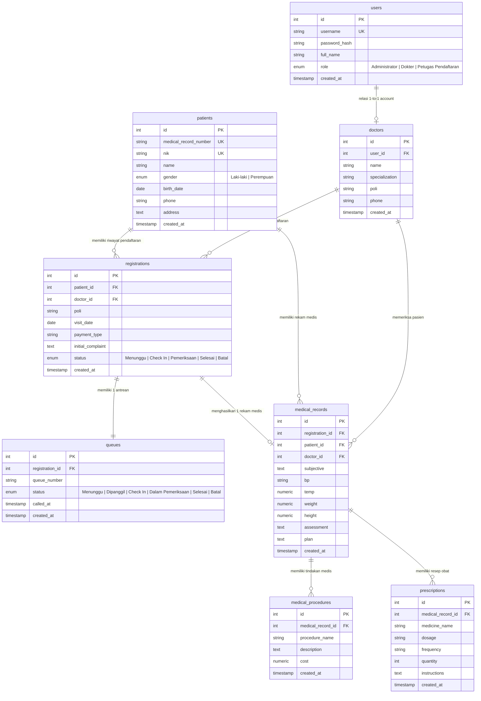

# Entity Relationship Diagram (ERD) - Mini Clinic Information System

Berikut adalah diagram relasi entitas (ERD) untuk aplikasi **Mini Clinic Information System**.

---

## Deskripsi Entitas Utama:

1. **`users`**: Menyimpan kredensial akun pengguna sistem (Administrator, Dokter, Petugas Pendaftaran) dengan enkripsi password `bcrypt`.
2. **`doctors`**: Menyimpan profil detail dokter terhubung ke akun `users` serta spesialisasi dan poli tempat praktek.
3. **`patients`**: Menyimpan Master Data Pasien dengan keunikan `nik` (16 digit) dan `medical_record_number` (Auto-generate `RM-YYYYMMDD-XXXX`).
4. **`registrations`**: Mencatat pendaftaran kunjungan berobat pasien ke poli & dokter tertentu.
5. **`queues`**: Mengelola status antrean pasien secara berurutan (`A001`, `A002`, dst.) yang terhubung otomatis dari modul pendaftaran.
6. **`medical_records`**: Mencatat pemeriksaan dokter menggunakan metode **SOAP** (Subjective, Objective, Assessment, Plan).
7. **`medical_procedures`**: Mencatat tindakan medis yang dilakukan saat pemeriksaan.
8. **`prescriptions`**: Mencatat resep obat yang diberikan oleh dokter (nama obat, dosis, aturan pakai, jumlah).
